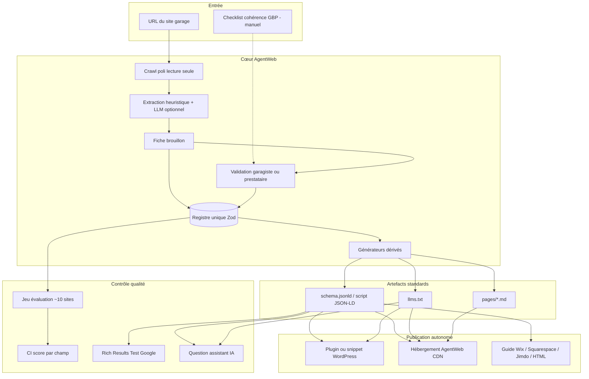

# Architecture cible — MVP pack visibilité IA

Document de **cadrage** (pas l’implémentation actuelle du jalon 1). Il décrit la cible alignée sur `docs/00-principes.md` et `docs/01-besoin.md`.

---

## Schéma (vue d’ensemble)

**Complément non prioritaire** : serveur **MCP lecture seule** alimenté par le même registre (jalon 1 déjà partiel).

---

## Choix techniques (avec alternatives rejetées)

| Sujet | Choix retenu | Alternative rejetée | Raison |
|-------|--------------|---------------------|--------|
| Source de vérité | **Registre Zod unique** (`BusinessOffer` + extensions garage) | Types TS + validation ad hoc + JSON-LD écrit à la main | Duplication actuelle ; risque d’écart JSON-LD / MCP / tests (principe #3) |
| Extraction par défaut | **Heuristiques + JSON-LD entrant** (jalon 1) | LLM systématique | Coût, variabilité, dépendance API (ADR 002) |
| LLM | **Optionnel**, clé en env, mesuré sur jeu d’éval | LLM obligatoire en production | Honnêteté coût/qualité ; garages sans budget API |
| Publication prioritaire | **JSON-LD schema.org** puis llms.txt / md | llms.txt seul | Effet Google documenté ; llms.txt non prouvé à grande échelle |
| RDV | **`ReserveAction` → URL existante** | Intégration agenda | Hors périmètre MVP ; pas de support multi-API |
| Déploiement | **Multi-mode** (client + hébergement AgentWeb) | AgentWeb uniquement hébergé | Autonomie (principe #4) ; certains garages refusent tiers |
| Mono-repo | **pnpm + TypeScript** (existant) | Microservices | Taille équipe ; partage registre |
| Tests qualité | **Jeu YAML/JSON figé + score champ** | Tests manuels seuls | Régression visible pour Benjamin |
| MCP MVP | **Lecture seule**, secondaire | MCP actions | Principe périmètre |

---

## Modèle de données — registre unique

**Concept** : une fiche **validée** est une instance conforme au schéma Zod canonique (évolution de `BusinessOffer` jalon 1).

| Domaine | Champs principaux | Consommateurs |
|---------|-------------------|---------------|
| Identité | nom légal / affichage, description, site, secteur `auto_repair` | JSON-LD `@type`, llms.txt en-tête |
| Contact | téléphone, e-mail, adresse postale, géo optionnelle | JSON-LD, NAP, checklist GBP |
| Horaires | `OpeningHoursSpecification` (créneaux, fermetures) | JSON-LD, llms.txt |
| Offres | prestations, catégories, prix optionnels | `OfferCatalog` / `Offer` |
| FAQ | questions / réponses | `FAQPage` si non vide |
| Actions | lien RDV, devis, contact — **kind** + URL | `potentialAction` / `ReserveAction` |
| Méta | version schéma, dates extraction/validation, sources URL | Journal, diff, CI |

**Règle** : les générateurs (`json-ld.ts`, `llms-txt.ts`, etc.) ne contiennent **que de la projection**, pas de nouveaux champs métier.

---

## Interfaces principales

| Interface | Utilisateur | Rôle |
|-----------|-------------|------|
| CLI / API « extract » | Agent IA, prestataire | URL → brouillon |
| UI ou fichier « validate » | Garagiste | Brouillon → fiche validée |
| CLI / API « publish » | Agent IA | Fiche validée → artefacts |
| Guides éditeur | Humain | Instructions copier-coller |
| Plugin WP / snippet | Humain ou agent | Injection `<script type="application/ld+json">` + `llms.txt` |
| Portail hébergement AgentWeb | Client | URL stable vers fichiers + webhook de refresh [À CLARIFIER] |
| MCP (lecture) | Agents avancés | Interrogation structurée — **non prioritaire vente** |

**Contrat outils** (aligné `docs/conventions.md`) : réponses `{ok:true,data}` / `{ok:false,error:{code,...}}`, journal JSONL par appel.

---

## Modes de publication (autonomie)

| Mode | Principe | Forces | Limites |
|------|----------|--------|---------|
| **WordPress** | Plugin ou thème enfant : JSON-LD dans `wp_head`, `llms.txt` à la racine (ou rewrite) | Marché large garages FR | Versions WP, caches, conflits avec Yoast/Rank Math |
| **Hébergement AgentWeb** | Fichiers sur CDN + snippet `<script src="...">` ou lien `llms.txt` proxy | Mise à jour centralisée, faible friction garagiste | Coût infra, dépendance AgentWeb, RGPD sous-traitant |
| **Wix / Squarespace / Jimdo** | Guide pas-à-pas (balise personnalisée, fichier statique) | Pas de dev backend | Pas toujours `llms.txt` à la racine ; JSON-LD parfois limité |
| **Site fait main / PHP** | Upload FTP / SFTP des fichiers générés | Contrôle total | Client doit ré-uploader après refresh |
| **Agent IA** | Télécharge zip, suit guide, vérifie Rich Results Test | Zéro Benjamin | Besoin doc machine-readable stricte |

Aucun mode ne garantit à lui seul la **racine** `https://domaine.fr/llms.txt` sur toutes les plateformes — à documenter par éditeur.

---

## Maintenance, rafraîchissement et coût (hypothèses)

| Poste | Hypothèse de travail | Ordre de grandeur indicatif [À CLARIFIER tarifs client] |
|-------|----------------------|--------------------------------------------------------|
| Re-crawl | 1× / semaine par client actif, ~30 pages, délai 1,5 s | ~45 s CPU crawl + stockage instantané < 5 Mo |
| Détection changement | Hash du `business-offer` validé vs nouveau brouillon | Alerte e-mail si delta > seuil |
| Hébergement statique | Object storage + CDN | [À CLARIFIER : €/client/mois] |
| Supervision | Uptime fichiers + échec CI par tenant | Outil monitoring existant ou léger |
| Support humain | Ciblé échec crawl / éditeur exotique | À isoler du « parcours standard » |

**Principe** : vendre le pack avec **refresh inclus** seulement si le coût ci-dessus est couvert par le prix [À CLARIFIER].

---

## Vérification de conformité aux principes

| Principe | Architecture |
|----------|--------------|
| #1 Périmètre garage / pas concierge | Pas de widget chat dans le schéma ; MCP actions absent |
| #2 Standards | Générateurs schema.org + llms.txt |
| #3 Registre unique | Zod central ; rejette duplication |
| #4 Autonomie | Table multi-mode publication |
| #5 Validation garagiste | Étape explicite avant `publish` |
| #6 Jeu d’éval + CI | Bloc `controle` |
| #7 Squelette E2E | Premier jalon implémentation = un garage réel |
| #8 Pas de promesse trafic | Hors architecture ; doc commerciale |
| #9 RGPD / secrets | Journaux masqués ; pas de clés en clair |
| #10 Maintenance | Section coût + refresh |

---

## Écart avec le jalon 1 (honneteté)

| Élément cible | Jalon 1 actuel |
|---------------|----------------|
| Zod registre | Validation TS manuelle |
| `ReserveAction` | Liens dans llms.txt seulement |
| Validation UI | Absent |
| Jeu d’éval CI | Absent |
| Déploiement | CLI locale uniquement |
| `{ok,data}` + JSONL | MCP JSON brut |

Voir inventaire détaillé : `docs/02-carte-des-couches.md`.
