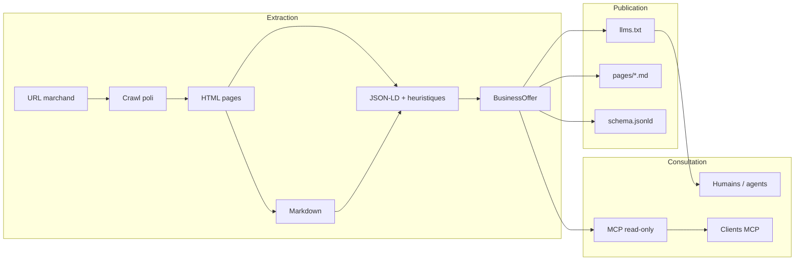

# Architecture AgentWeb (jalon 1)

## Vue d’ensemble

## Briques

### `packages/core`

Modèle **sector-agnostic** : identité, contact, horaires, offres, FAQ, liens d’action, pages sources et métadonnées d’extraction. Validation minimale pour garantir des instantanés cohérents.

### `packages/extractor`

1. **Découverte** : `sitemap.xml` / `wp-sitemap.xml` si présent, sinon exploration des liens internes.
2. **Politesse** : `robots.txt`, user-agent `AgentWeb/0.1`, délai configurable entre requêtes.
3. **Rendu** : `fetch` par défaut ; Playwright optionnel (`--playwright` ou `AGENTWEB_USE_PLAYWRIGHT`).
4. **Contenu** : Cheerio + Turndown pour un Markdown lisible.
5. **Structuration sans LLM** : JSON-LD schema.org, `tel:` / `mailto:`, listes à puces avec prix, motifs d’horaires français, liens RDV/devis.
6. **Extension LLM** : hook `maybeEnrichWithLlm` activé uniquement si une clé API est fournie (non utilisé dans le POC par défaut).

### `packages/publisher`

Génère :

- `llms.txt` ([spécification llmstxt.org](https://llmstxt.org/))
- `pages/*.md` (une page crawlée = un fichier)
- `schema.jsonld` (`AutoRepair` ou `LocalBusiness`, `OpeningHoursSpecification`, `OfferCatalog`, `FAQPage` si FAQ)

### `packages/mcp-server`

Serveur MCP officiel (`@modelcontextprotocol/sdk`) en **lecture seule**. Les outils renvoient du JSON textuel ; `get_booking_options` ne déclenche aucune action côté serveur.

### `apps/cli`

Orchestration locale : `extract`, `publish`, `serve-mcp`.

## Choix techniques (résumé)

| Sujet | Choix | Motivation |
|-------|--------|------------|
| Mono-repo | pnpm workspaces | Partage de types, builds isolés |
| Langage | TypeScript ESM | Alignement SDK MCP, typage du modèle |
| Crawl | fetch + sitemap + BFS | Simple, sans infra ; respect robots |
| Parsing | Cheerio + heuristiques | Pas de coût API, fonctionne hors ligne |
| Tests | Vitest | Rapide, natif ESM |
| CI | GitHub Actions | `pnpm install`, build, lint, test |

Les décisions détaillées sont dans [`docs/adr/`](adr/).

## Limites connues (jalon 1)

- Structuration **imparfaite** sur sites sans JSON-LD ni listes de prix explicites.
- Horaires : regex française + schema.org ; les tableaux visuels atypiques peuvent être incomplets.
- Offres : fusion liste Markdown + catalogue JSON-LD ; doublons possibles avant affinage.
- Pas de cache HTTP, pas de diff temporel, pas d’authentification marchand.
- Playwright non installé par défaut (dépendance optionnelle).
